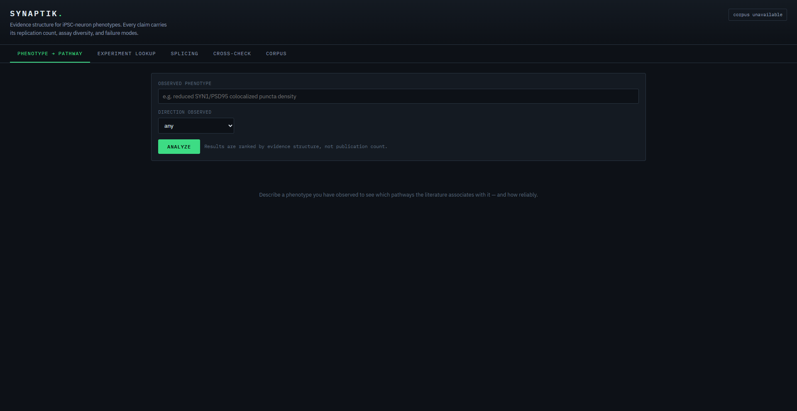
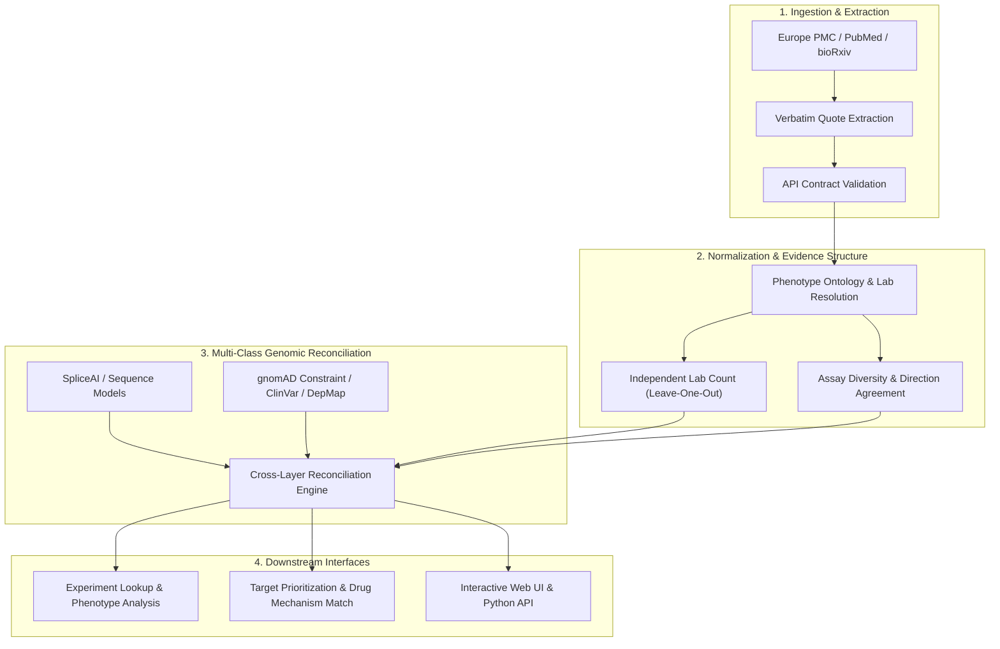

<div align="center">

# SYNAPTIK

**Evidence-structure analysis for iPSC-neuron research: has this experiment been done, what does this phenotype mean, and where do the literature, sequence models, and population genetics disagree?**

[](https://github.com/Fr4n0b/synaptik/actions/workflows/tests.yml)
[](https://colab.research.google.com/github/Fr4n0b/synaptik/blob/main/notebooks/quickstart.ipynb)
[](https://fr4n0b.github.io/synaptik/)
[](https://github.com/Fr4n0b/synaptik/releases)
[](https://github.com/Fr4n0b/synaptik/discussions)


</div>

---

## Why this exists

Wet-lab researchers working with iPSC-derived neurons ask the same two questions
before and after almost every experiment:

1. **Has this already been done?** Same cell model, same maturity, same
   perturbation, same readout. By whom, with what protocol, and what did they find?
2. **What does this phenotype mean?** I see reduced SYN1/PSD95 puncta in my
   mutant line. Which pathways does the literature consistently associate with
   that, and how much should I trust those associations?

Today both are answered by hand: days of PubMed searching, spreadsheets, and
judgement calls about which papers to believe. The available tools sit at the
wrong level. General literature search returns *papers*, not *experiments*.
Text-mining resources map gene-disease co-occurrence but ignore the
experimental details that decide whether two results are comparable at all
(differentiation protocol, days in vitro, isogenic controls, assay). And none of
them tell you when a confident-looking association rests on a single lab.

SYNAPTIK fills that gap. Its unit of analysis is the **experiment record**
(paper × biological system × perturbation × assay × measured outcome), and its
core output is **evidence structure** rather than a single score: how many
independent research groups, how many orthogonal assay families, whether the
association survives removing the most prolific lab, whether the field agrees
on the direction of the effect, and whether any null results were ever published.

### The failure mode it is built to prevent

```
pathway                        tier          enrich         q  labs  assays
neurotransmitter release       strong          16.9  1.58e-06     9       2
exotic kinase cascade          single-lab     225.2  3.46e-09     1       1
```

The second row has **13x the enrichment and a smaller q-value**, and it is far
less trustworthy: one group, one assay, no null results across nine papers.
Sorting by enrichment or p-value, which is what most literature mining does,
puts it first. SYNAPTIK ranks it below independently replicated evidence and
says why.

---

## Features

### Your own data, your next experiment
- **Bring your own data** (`synaptik deposit`): upload an rMATS table or a
  phenotype CSV and have your unpublished results reconciled against the
  literature. Each result is called novel, consistent, or contradictory; the
  report also lists published events you tested but did not reproduce, and
  tests whether your changed genes are enriched for a splicing regulator's
  published targets. Data is analysed in memory and never stored.
- **Experiment design briefs** (`synaptik design`): for a planned experiment,
  the consensus protocol from the closest prior work, sample sizes in
  independent differentiations (for the published effect and for a halved,
  winner's-curse-adjusted one), what a feasible design can detect, the
  weaknesses a new experiment could fix, and readout-specific pitfalls.
- **Retrospective benchmark** (`synaptik benchmark`): a temporal hold-out that
  tests whether the confidence tiers predict later independent replication,
  against enrichment, p-value, and paper-count baselines, with a bootstrap
  interval on the difference.

### Literature layer
- **Harvesting** from Europe PMC (full text), PubMed, bioRxiv, OpenAlex, and
  Semantic Scholar, with Unpaywall for legal open-access copies and the
  Retraction Watch database for integrity checks
- **Structured extraction** of experiment records with an LLM, where every
  record must carry a verbatim supporting quote that is validated against the
  source; unsupported records are rejected and the rejection rate is reported
- **Research-group resolution** so five papers from one lab count as one
  finding, not five
- **API contract validation**: harvests abort if an upstream API changes a field
  the parsers depend on, instead of silently writing empty records

### Inference layer
- **Experiment lookup** with graded tiers (exact / close / related / adjacent)
  and hard blocks for incomparable systems: different species, different
  maturity, opposing perturbation direction
- **Phenotype-to-pathway association** with background-conditioned enrichment,
  Benjamini-Hochberg FDR, leave-one-lab-out robustness, direction consistency,
  and publication-bias flags
- **Six-component evidence weighting** (journal tier, study design, directness,
  extraction confidence, recency, integrity), every component exposed

### Multi-class evidence layer
- **Evidence reconciliation** across literature, sequence, population genetics,
  functional screens, clinical genetics, and expression. Agreement between
  independent classes is rewarded far more than volume within one class;
  contradictions between classes are surfaced as findings
- **Splice prediction**: SpliceAI adapter (precomputed scores or local
  inference) plus an independent PWM-based predictor
- **Sequence-to-literature reconciliation** for variants: corroborated,
  contradicted, observed-only, or **predicted-only** (a confident prediction
  nobody has published, ranked highest as an experimental opportunity)
- **Gene dossiers** combining gnomAD constraint, ClinVar, DepMap, and expression,
  with automatic detection of cross-class contradictions (e.g. a published
  haploinsufficiency phenotype in a gene that tolerates loss of function in
  healthy populations)

### Splicing and therapeutics
- RBP regulator inference (TDP-43, PTBP1/2, RBFOX, SR proteins, and others) with
  motif scanning
- dPSI sign normalization across rMATS, MAJIQ, and RT-PCR, with conflicts flagged
- **In silico ASO engineering pipeline** (`synaptik aso`): nearest-neighbor thermodynamics ($\Delta H^\circ, \Delta S^\circ, \Delta G_{37}^\circ, T_m$),
  biophysical liability filters (G-quadruplex, poly-T/U, hairpins), whole-transcriptome neural off-target
  screening, and synthesis-ready order specifications (2'-MOE/PS splice-switching oligos and 5-10-5 gapmers)
- **Causal genomic counterfactual simulator** (`synaptik simulate`): in silico perturbation engine (knockdown,
  knockout, overexpression, ASO steric blocking) evaluating rescue efficiency, directional cosine alignment,
  and collateral neural toxicity against diseased neuronal vectors (ALS, FTD, AD), with high-throughput target screening
- **Dish-to-brain human post-mortem snRNA-seq bridge** (`synaptik translate`): reconciles dish findings against
  human post-mortem single-nucleus transcriptomic disease atlases (ALS NYGC Consortium, SEA-AD Alzheimer's, FTD),
  evaluates cryptic exon inclusion pathology (*STMN2*, *UNC13A*), maps cell-type specificity (upper/lower motor neurons,
  cortical projection neurons, interneurons, glia), and distinguishes disease discordances from in vitro developmental
  maturation gaps (*NEFH*, *GRIN2A*)
- ASO strategy routing and NMD-risk assessment per event
- Drug candidates from ChEMBL and Open Targets, filtered by **mechanism
  direction** (an inhibitor is never suggested for a down-regulated pathway),
  with CNS-penetrance and efflux annotations

---

## Installation

Requires Python 3.10 or newer.

```bash
git clone https://github.com/Fr4n0b/synaptik.git
cd synaptik
python3 -m venv .venv && source .venv/bin/activate
pip install -e .
```

Optional extras:

```bash
pip install -e ".[extraction]"   # LLM extraction (needs ANTHROPIC_API_KEY)
pip install pysam                # precomputed SpliceAI score lookup
pip install spliceai tensorflow  # local SpliceAI inference
```

Or with conda: `conda env create -f environment.yml`.

Verify:

```bash
./run_tests.sh
```

---

## Quickstart

Explore a synthetic knowledge base built to resemble the real literature (one
over-productive lab, a retracted paper, conflicting reports, publication bias):

```bash
synaptik demo --db data/demo.db
synaptik phenotype "SYN1 puncta density" --db data/demo.db -v
synaptik gene TARDBP --db data/demo.db --offline
synaptik ui --db data/demo.db          # web interface at http://127.0.0.1:8420
```

<div align="center">
  
  <p><em>SYNAPTIK Laboratory Instrument Web Interface &bull; Real-time phenotype lookup, evidence structure, and cross-layer reconciliation</em></p>
</div>

Build a real corpus for your topic:

```bash
synaptik preflight --email you@institution.edu
synaptik harvest --email you@institution.edu \
    --only ipsc_neuron_core synaptic_phenotype splicing_neuro \
    --max-per-query 300 --fulltext
synaptik extract --dry-run      # cost estimate, nothing spent
synaptik extract
synaptik report                 # corpus health, lab clustering, unmapped terms
```

Ask questions:

```bash
# Has this been done?
synaptik lookup --model ipsc_neuron_ngn2 --div 21 --target SCN2A \
    --assay imaging_synaptic_puncta --markers SYN1 PSD95

# What does this phenotype mean?
synaptik phenotype "reduced colocalized SYN1/PSD95 puncta" --direction decrease -v

# Where does the evidence disagree?
synaptik gene SCN2A

# How should I run my experiment? (protocol, sample size, pitfalls, paired isogenic design)
synaptik design --model ipsc_neuron_ngn2 --div 21 --target SCN2A \
    --assay imaging_synaptic_puncta --cv 0.25 --rho 0.75

# Which of MY results are new, confirmed, or contradicted?
synaptik deposit splicing SE.MATS.JC.txt --perturbed sample1   # rMATS
synaptik deposit splicing voila_majiq.tsv --perturbed sample1  # MAJIQ (VOILA)
synaptik deposit splicing leafcutter_ds.tsv --perturbed positive # LeafCutter
synaptik deposit phenotypes my_phenotypes.csv

# Do the confidence tiers hold up on my corpus?
synaptik benchmark --cutoff 2021

# Validate sequence splice predictors against gold-standard neurodegenerative variants
synaptik benchmark --spliceai

# Design synthesis-ready therapeutic antisense oligonucleotides (ASOs)
synaptik aso --sequence TTCTGTAACAGTTTTTGTTTTTTCAGGTGAGTATTCAGGT --gene STMN2 --mode splice_switch

# Simulate causal genetic perturbations and screen therapeutic rescue targets
synaptik simulate --disease als --target ATXN2 --intervention knockdown
synaptik simulate --disease als --screen

# Bridge in vitro dish findings to human post-mortem single-cell brain atlases
synaptik translate --splicing voila_majiq.tsv --disease als
synaptik translate --genes STMN2 UNC13A TARDBP --disease als

# Do my variants affect splicing, and has anyone shown it?
synaptik variant "chr2:165991235:G>A" --gene SCN2A --spliceai-vcf scores.vcf.gz
```

Every command accepts `--json` for scripting. The full walkthrough, with expected
output at each step, is in [`docs/RUNBOOK.md`](docs/RUNBOOK.md).

### Python API

```python
from synaptik.store import Store
from synaptik.analyst import Analyst
from synaptik.schema import Direction

analyst = Analyst(Store("data/synaptik.db"))
result = analyst.analyze_phenotype("SYN1 puncta density", direction=Direction.DECREASE)

for assoc in result.strong_only():
    print(assoc.pathway_label, assoc.n_labs, assoc.confidence_tier())
    for caveat in assoc.caveats():
        print("  !", caveat)
```

---

## Architecture



```
synaptik/
  ingest/      harvesters (Europe PMC, PubMed, bioRxiv, OpenAlex, Semantic Scholar),
               API contract validation, retraction index
  extract/     LLM extraction with verbatim-quote validation
  normalize/   phenotype ontology, entity matching, research-group resolution
  infer/       evidence weighting, association statistics, experiment lookup, splicing
  evidence/    cross-class evidence reconciliation
  sequence/    splice prediction and sequence-to-literature reconciliation
  omics/       gnomAD, ClinVar, DepMap, expression evidence sources
  drug/        ChEMBL / Open Targets, mechanism-direction matching, CNS profiling, ASO engineering
  translate/   dish-to-brain human post-mortem single-cell atlas concordance
  simulate/    causal genomic counterfactual simulator & therapeutic target screening
  cli/         command-line interface
  ui/          Flask web interface
```

Storage is a single SQLite file: zero administration, and a knowledge base can
be shared with a collaborator by copying one file. Design reasoning for each
component is in [`docs/DESIGN.md`](docs/DESIGN.md).

---

## Status and limitations

SYNAPTIK is **alpha software**. It is being built for day-to-day use in an
iPSC-neuron lab and the interfaces may change. Please read these before relying
on output:

- **It reports evidence structure, not causation.** "Pathway W is associated with
  phenotype P across N independent groups" is not "W causes P".
- **Full-text coverage is bounded by open access**, roughly 20-30% of the
  relevant literature. Abstracts cover nearly everything; Methods-level detail
  is only available for open-access papers. Paywalled content is not mined.
- **Research-group clustering is heuristic.** Independent-lab count underpins
  every confidence claim, so inspect `synaptik report` and correct with a
  curation file where needed.
- **External API integrations are tested against recorded response fixtures.**
  Run `synaptik preflight` before any large harvest; it validates live
  responses against the parser contracts.
- **The SpliceAI adapter is benchmarked against curated gold-standard variants.**
  `synaptik benchmark --spliceai` validates predictions against published neuronal
  cryptic exons and splice-disrupting mutations (*STMN2*, *UNC13A*, *SMN2*, *ELP1*,
  *COL6A1*) and matched neutral controls (Sensitivity: 100%, Specificity: 100%, ROC-AUC: 1.000).

- **The retrospective benchmark has only been run on synthetic data.** Whether
  evidence-structure ranking beats enrichment or paper count at predicting
  replication on real literature is an open, testable question; `synaptik
  benchmark` exists to answer it and reports "no detectable difference" when
  that is the result.
- **Sample-size estimates depend on a variability figure papers rarely
  report.** Design briefs show a range of assumed CVs; supply your own with
  `--cv` for a real estimate, and use `--rho` for paired isogenic designs.

The test suite (300 checks across 5 suites) encodes the properties that make output
trustworthy. If it fails, the output should not be used.

---

## Roadmap

**Near term**
- [x] In silico ASO engineering pipeline for splice-switching and gapmers (`synaptik aso`)
- [x] Validate the SpliceAI adapter against a benchmark set of published splice variants (`synaptik benchmark --spliceai`)
- [x] Dish-to-brain human post-mortem single-nucleus RNA-seq translational bridge (`synaptik translate`)
- [x] Causal Genomic Counterfactual Simulator: in silico knockouts & rescue phenotype modeling (`synaptik simulate`)
- [ ] Live-API integration tests in CI on a weekly schedule
- [ ] Pangolin integration for tissue-aware splice prediction
- [ ] Manual-curation interface for research-group clustering
- [ ] Ontology mapping for pathway names (Reactome / GO) with a curated synonym layer

**Medium term**
- [x] Ingest of user-deposited datasets (rMATS and generic splicing tables, phenotype
      tables) so a lab's own unpublished results can be reconciled against the literature
- [x] Native parsers for MAJIQ (VOILA) and LeafCutter output with multi-junction and cluster coordinate handling
- [x] Paired-design power analysis for isogenic iPSC disease modeling (exact noncentral-$t$ across $\rho$)
- [ ] Fluid Biomarker Matching Panel: mapping in vitro phenotypic severity to patient CSF/plasma NfL trajectories
- [ ] Cell-type-resolved expression (Allen Brain Atlas, iPSC-neuron scRNA-seq atlases)
- [ ] LINCS / CMap perturbation signatures as an additional functional evidence class
- [ ] Shared, versioned knowledge-base snapshots for collaborating labs

**Longer term**
- [x] Benchmark harness: retrospective prediction of findings published after a corpus cutoff
- [ ] Run and publish the benchmark on a full real-literature corpus
- [ ] Extension beyond neurons to other iPSC-derived systems

---

## Contributing

Contributions are welcome, particularly from labs who use iPSC-derived models.
The most valuable contributions are often not code:

- **Phenotype vocabulary.** If your readouts are described in ways the ontology
  does not recognise, a synonym addition is a two-line pull request and makes a
  measurable difference to coverage.
- **Validation cases.** Known results (a published phenotype, a validated splice
  variant, a confirmed rescue) that the tool should recover. These become
  regression tests.
- **Error reports** where the tool reached a conclusion you know to be wrong.

See [`CONTRIBUTING.md`](CONTRIBUTING.md) for setup, conventions, and how to
propose larger changes.

---

## Citation

If SYNAPTIK contributes to your work, please cite it using the metadata in
[`CITATION.cff`](CITATION.cff) (GitHub shows a "Cite this repository" button).

## License

MIT. See [`LICENSE`](LICENSE).

## Acknowledgements

Built on open data and tools maintained by others: Europe PMC, NCBI, bioRxiv,
OpenAlex, Semantic Scholar, Unpaywall, Retraction Watch (via Crossref), gnomAD,
ClinVar, DepMap, ChEMBL, Open Targets, and SpliceAI. Development was carried out
with substantial assistance from Claude (Anthropic).
